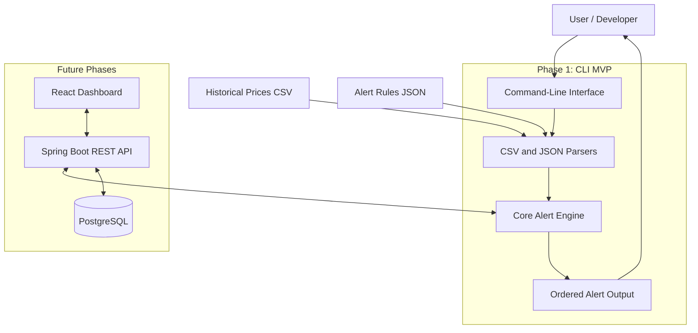
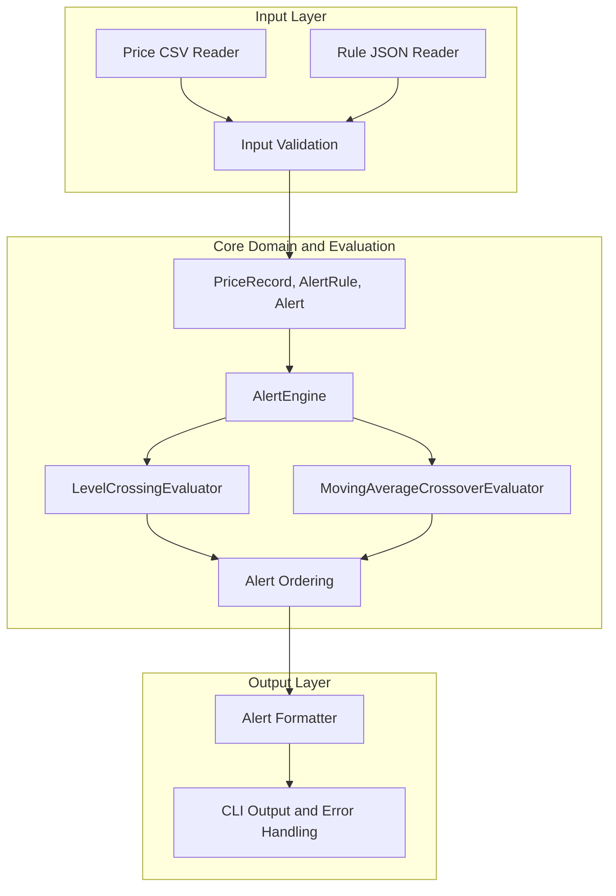
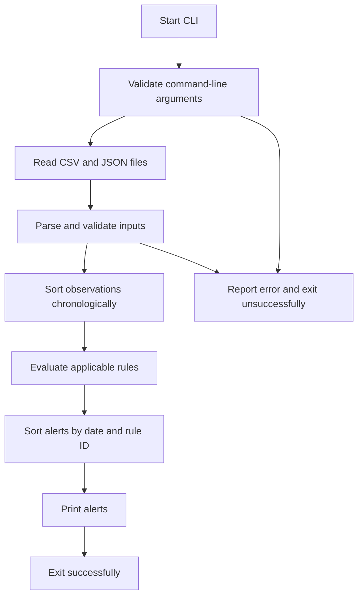
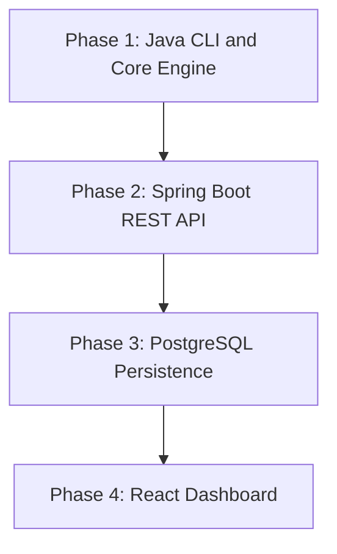

# Price Alert Tool — High-Level Design (HLD)

## 1. Overview

The Price Alert Tool is a software application that processes historical instrument prices and user-defined alert rules to identify significant price events. The initial version is a command-line application that reads a CSV file containing historical prices and a JSON file containing alert rules, evaluates the rules, and prints matching alerts in a deterministic order.

The application will be developed incrementally, starting with a reliable core engine and CLI. Future phases may expose the same engine through a REST API, persist evaluation history in PostgreSQL, and provide a web dashboard.

## 2. Objectives

- Read historical price records from a CSV file.
- Read alert rules from a JSON file.
- Support level-crossing and moving-average crossover alerts.
- Process records chronologically, even when the input CSV is unordered.
- Generate deterministic alert output ordered by alert date and then rule ID.
- Validate input and report useful errors.
- Provide automated tests and clear setup instructions.
- Keep the core alert engine independent of the CLI, REST API, database, and frontend.

## 3. Functional Requirements

### Phase 1 — CLI MVP

1. Accept a historical prices CSV file and an alert rules JSON file.
2. Parse and validate both input files.
3. Sort price observations chronologically before evaluating rules.
4. Evaluate level-crossing rules.
5. Evaluate moving-average crossover rules using complete moving-average windows.
6. Generate alerts containing the relevant date, rule ID, instrument, and alert details.
7. Sort final alerts by date and then rule ID.
8. Print results to standard output and report invalid input through standard error.
9. Exit with an appropriate status code when execution fails.
10. Include unit tests and a README with build and execution instructions.

### Future Phases

- Expose alert evaluation through a REST API.
- Persist evaluation history and generated alerts in PostgreSQL.
- Provide a React and TypeScript dashboard.
- Add evaluation history, observability, and improved operational controls where time permits.

## 4. Non-Functional Requirements

- **Correctness:** Alert decisions must follow explicitly defined rule semantics.
- **Determinism:** The same valid input must produce the same ordered output.
- **Maintainability:** Responsibilities must be separated into small, testable components.
- **Testability:** Core logic must be testable without starting a web server or connecting to a database.
- **Usability:** A developer should be able to build and run the CLI using documented commands.
- **Extensibility:** Future interfaces should reuse the core engine rather than duplicate its logic.
- **Input safety:** Malformed files and invalid rules must produce clear errors instead of unexplained failures.

## 5. Technology Stack

| Component | Technology | Purpose |
|---|---|---|
| Language | Java 21 | Core application |
| Build tool | Maven | Dependency and build management |
| CSV processing | Apache Commons CSV | Read historical prices |
| JSON processing | Jackson | Read alert rules |
| Testing | JUnit 5 | Automated tests |
| REST API — future | Spring Boot | HTTP interface |
| Database — future | PostgreSQL | Persist evaluation history |
| Database migrations — future | Flyway | Versioned schema management |
| Persistence — future | Spring Data JPA | Database access |
| Frontend — future | React + TypeScript | User interface |

The Phase 1 implementation will use plain Java and Maven. Spring Boot, PostgreSQL, and React are planned extensions, not prerequisites for the CLI MVP.

## 6. High-Level Architecture

### 6.1 System Context Diagram



### 6.2 Component Architecture



### 6.3 Architectural Principles

- Keep business rules in the core engine.
- Keep file parsing and command-line handling outside the core engine.
- Represent prices and financial calculations using `BigDecimal` rather than binary floating-point values.
- Preserve JSON decimal precision when deserializing rule thresholds.
- Use `LocalDate` for observation and alert dates.
- Evaluate each instrument's observations in chronological order.
- Treat the supplied observations as the sequence; calendar gaps do not affect evaluation.
- Make alert ordering explicit rather than relying on incidental collection order.
- Add future interfaces around the same core engine.

## 7. Core Domain Model

### PriceRecord

Represents one historical price observation.

- `date`: `LocalDate`
- `instrument`: `String`
- `close`: `BigDecimal`

The date, instrument, and close are required. Closing prices must be strictly positive.

### AlertRule

Represents a user-defined condition.

Common fields include:

- `id`: unique rule identifier
- `instrument`: instrument to evaluate
- `type`: rule type
- Additional parameters required by the rule type

Supported rule types:

- `level`
- `ma_cross`

A LEVEL rule requires a numeric level, which may be zero or negative, and may specify `direction` as `above` or `below`. An MA_CROSS rule requires positive integer short and long windows, with the short window strictly less than the long window, and may specify `direction` as `above` or `below`. The current JSON reader also accepts legacy `threshold`, `shortWindow`, and `longWindow` field names; if both an official name and its legacy alias appear, their values must match. If direction is omitted, both crossing directions are evaluated for compatibility.

Thresholds are represented as `BigDecimal`; JSON numeric precision is preserved during deserialization.

### Alert

Represents a rule that has triggered.

It should include:

- Alert date
- Rule ID
- Instrument
- Alert type or description
- Relevant values needed to explain the trigger

Exact field names and serialized output will be finalized in the low-level design and implementation.

## 8. Alert Evaluation Logic

### 8.1 Level-Crossing Rule

A level-crossing rule evaluates consecutive observed closing prices for its instrument against a configured threshold `T`:

- Upward crossing: previous price `<= T` and current price `> T`.
- Downward crossing: previous price `>= T` and current price `< T`.

The first observation has no previous price and cannot trigger a crossing. Comparisons use `BigDecimal`; equality is included only on the previous-price side of each condition.

### 8.2 Moving-Average Crossover Rule

A moving-average crossover rule compares two moving averages calculated from historical closing prices.

- The short-window moving average uses the configured shorter window.
- The long-window moving average uses the configured longer window.
- A moving average is unavailable until its complete window of observations exists.
- A comparison requires complete short and long windows at both the current and previous comparison points.
- Bullish crossover: previous short MA `<=` previous long MA, and current short MA `>` current long MA.
- Bearish crossover: previous short MA `>=` previous long MA, and current short MA `<` current long MA.

The evaluator maintains rolling `BigDecimal` sums. It compares the averages exactly by cross-multiplying the sums and window lengths; it does not divide, round, or convert to binary floating point for crossover decisions.

### 8.3 Chronological Processing

Input rows may not be in chronological order. Therefore, records must be sorted by date before evaluation.

Observations must be evaluated separately for each instrument. Rule evaluation must not accidentally combine prices belonging to different instruments.
Only observed records determine sequence and adjacency; calendar gaps are ignored.

### 8.4 Alert Ordering

After evaluation, all generated alerts must be sorted by:

1. Alert date in ascending order.
2. Rule ID in ascending order when dates are equal.

If multiple alerts have the same date and rule ID, their ordering must be defined if such duplicates are possible under the final data and rule semantics.

## 9. Data Flow

### Phase 1 — CLI Evaluation



## 10. Input and Output Contracts

### Historical Prices CSV

The initial CSV format is:

```csv
date,instrument,close
2026-01-01,ABC,100.00
2026-01-02,ABC,105.00
2026-01-03,ABC,102.00
```

Requirements:

- Required columns: `date`, `instrument`, `close`.
- Dates use ISO format: `YYYY-MM-DD`.
- Prices must be valid, strictly positive decimal values.
- Rows may be unordered and must be sorted before evaluation.
- Invalid or incomplete records must be handled according to the documented validation policy.

### Alert Rules JSON

The rules file will contain a JSON array of rule objects.

The CLI accepts exactly two arguments: the prices CSV path followed by the rules JSON path. A header-only CSV and an empty rules array are valid inputs. Either can result in a successful evaluation with no alerts; the CLI prints `No alerts generated.` and exits successfully.

Illustrative structure:

```json
[
  {
    "id": "r1",
    "instrument": "INFY",
    "type": "level",
    "direction": "below",
    "level": 1500
  },
  {
    "id": "r2",
    "instrument": "TCS",
    "type": "ma_cross",
    "short": 5,
    "long": 20,
    "direction": "above"
  }
]
```

This example communicates the intended structure; the final field requirements must match the implemented rule model and README.

### Output

The CLI prints matching alerts in deterministic order. Error messages go to standard error. The final output format will be documented and verified through automated tests.

## 11. Error Handling and Validation

The application should validate:

- Missing or unreadable input files.
- Missing required CSV columns.
- Invalid dates and decimal values.
- Zero or negative closing prices.
- Missing required rule fields.
- Unsupported rule types.
- Invalid window sizes.
- Duplicate rule IDs.
- Duplicate observations for the same instrument and date.
- Invalid instrument identifiers.
- Missing CSV headers and malformed CSV rows.

Errors should identify the relevant file, row, field, or rule where practical. The program should not silently treat invalid data as valid input.

Calendar gaps do not invalidate data; only duplicate instrument/date observations are rejected. A file containing no CSV header is invalid, while a CSV containing only the required header is valid and has no observations.

## 12. Performance Considerations

Let:

- `N` be the number of historical price records.
- `R` be the number of alert rules.

Sorting the input records costs `O(N log N)` time.

The current implementation scans the input records for each rule, so evaluation is `O(NR)` after record validation and sorting, in addition to alert sorting at `O(A log A)`. Sorting records costs `O(N log N)`. Moving-average window sums are updated incrementally while each applicable rule is evaluated.

The MVP prioritizes correctness and clarity over premature optimization.

## 13. Testing Strategy

### Unit Tests

- Level crossing above and below a threshold.
- Equality at the threshold.
- First observation behavior.
- Moving-average crossover.
- Insufficient observations for a complete moving-average window.
- Independent processing of multiple instruments.
- Unordered input records.
- Alert ordering by date and rule ID.
- Invalid rule parameters.
- Duplicate rule identifiers and duplicate observations according to the chosen policy.

### Integration Tests

- Read valid CSV and JSON files.
- Execute the CLI with valid input files.
- Verify deterministic output.
- Verify invalid input produces a useful error and unsuccessful exit status.
- Verify the documented build and run commands.

Tests must assert the expected behavior; merely compiling the project is not sufficient evidence of correctness.

## 14. Implementation Phases and Dependencies



### Phase 1 — CLI MVP

- Implement domain models and evaluators.
- Implement CSV and JSON parsing.
- Add validation and deterministic output.
- Write unit and integration tests.
- Document build, run, and test commands.

### Phase 2 — REST API

- Add a Spring Boot application layer.
- Expose an endpoint for alert evaluation.
- Reuse the existing core engine.
- Validate request payloads and return structured responses.
- Add API-level tests.

### Phase 3 — Persistence

- Integrate PostgreSQL.
- Use Flyway for schema migrations.
- Store evaluation runs and generated alert records.
- Add persistence tests and appropriate transaction boundaries.

### Phase 4 — Dashboard

- Build a React and TypeScript interface.
- Submit evaluation requests to the REST API.
- Display generated alerts and evaluation history.
- Add user-facing validation and error states.

The later phases are extensions. The CLI MVP must remain independently buildable and usable.

## 15. Open Design Decisions

The current CLI/domain policies define crossing equality, first-observation behavior, duplicate observation and rule-ID rejection, ignored calendar gaps, and invalid-input rejection. Future interfaces must preserve or deliberately version these policies. The output format is documented by the CLI README and can evolve independently of the core alert model.

## 16. Scope Boundaries

The initial deliverable is a reliable, tested command-line application. A production-grade trading platform, live market-data ingestion, real-time broker integration, authentication, authorization, distributed processing, and deployment infrastructure are outside the MVP scope unless explicitly required later.

The design aims to demonstrate sound software engineering fundamentals: separation of concerns, deterministic behavior, clear contracts, input validation, automated testing, and an incremental path toward a service-oriented architecture.
