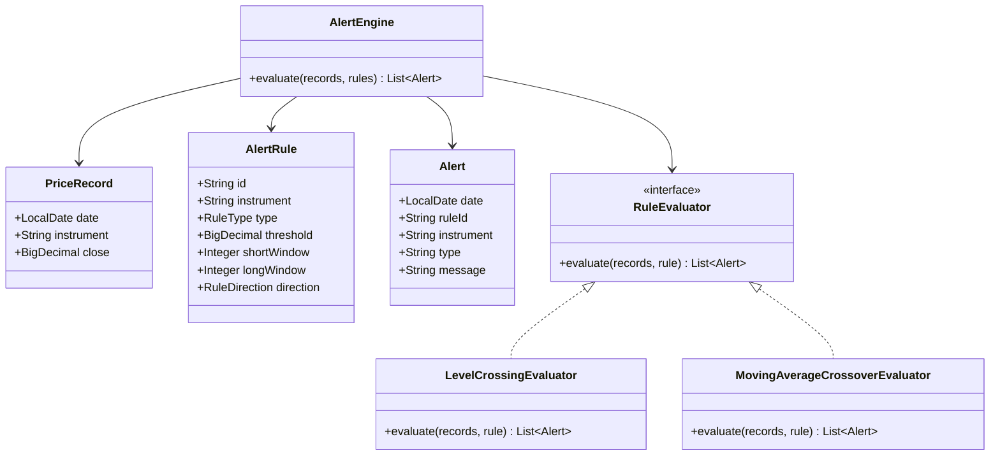
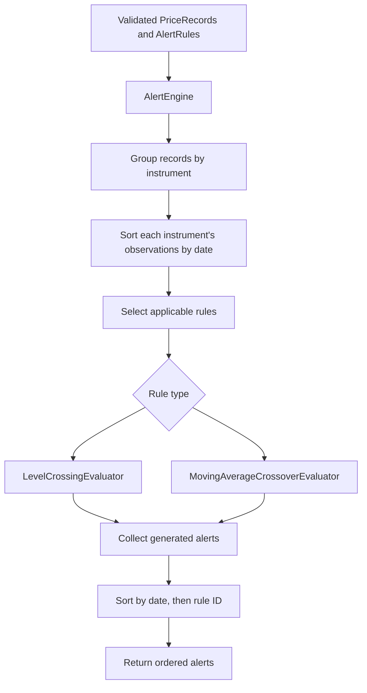
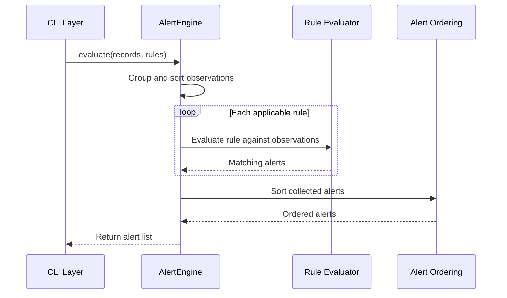

# Low-Level Design 01 — Core Alert Engine

## 1. Purpose

This document defines the internal design of the Price Alert Tool's core evaluation engine. The engine evaluates historical price observations against configured alert rules and returns alerts in a deterministic order.

The core engine must remain independent of command-line handling, CSV/JSON parsing, REST APIs, databases, and frontend technologies.

## 2. Responsibilities

The core engine is responsible for:

- Representing price observations, rules, and alerts.
- Evaluating level-crossing rules.
- Evaluating moving-average crossover rules.
- Processing observations chronologically for each instrument.
- Preventing calculations from mixing instruments.
- Producing alerts in date-then-rule-ID order.
- Applying explicitly defined validation and rule semantics.

File reading, JSON parsing, console output, and process exit codes belong to the CLI layer.

## 3. Class Diagram

The diagram shows the intended logical design. Exact Java signatures and fields may be adjusted to match the final implementation.

## 4. Domain Models

### 4.1 PriceRecord

Represents one observed closing price.

Fields:

- `LocalDate date`
- `String instrument`
- `BigDecimal close`

Design considerations:

- Use `LocalDate` for date-only observations.
- Use `BigDecimal` for decimal prices.
- Validate that required fields are present.
- Require `close` to be strictly positive.

### 4.2 AlertRule

Represents a configured condition to evaluate.

Common fields:

- `String id`
- `String instrument`
- Rule type

Type-specific parameters:

- Level rule: level/threshold and optional direction.
- Moving-average crossover rule: short and long window sizes.

The implementation uses Java enums for rule types and optional direction. LEVEL requires a numeric level (the legacy `threshold` alias is supported) but does not constrain its sign. MA_CROSS requires positive windows (the legacy `shortWindow`/`longWindow` names are supported) with short less than long. Explicit direction restricts evaluation to that crossing; omitted direction retains the legacy both-directions behavior. JSON level numbers are read as `BigDecimal` without losing decimal precision.

### 4.3 Alert

Represents a triggered condition.

The output model should contain enough information to identify and explain the alert:

- Alert date.
- Rule ID.
- Instrument.
- Alert type.
- Human-readable description or relevant values.

The alert model should not depend on console formatting or HTTP response classes.

## 5. Core Engine Architecture

## 6. Class Responsibilities

### 6.1 AlertEngine

The orchestration component.

Responsibilities:

1. Receive validated records and rules.
2. Organize records by instrument.
3. Sort observations chronologically.
4. Match rules to their instruments.
5. Delegate evaluation to the appropriate evaluator.
6. Collect generated alerts.
7. Sort alerts by date and rule ID.
8. Return the result without printing to the console.

The engine should not read files, parse JSON, or manage process exit codes.

### 6.2 RuleEvaluator

An interface representing a rule-specific evaluator.

It allows the engine to delegate evaluation without embedding every algorithm in one large method.

### 6.3 LevelCrossingEvaluator

Evaluates a price series against a configured threshold.

It must use consecutive observations from the same instrument and apply the chosen crossing semantics consistently.

### 6.4 MovingAverageCrossoverEvaluator

Calculates short- and long-window moving averages and identifies crossovers after both windows are complete.

It should avoid repeatedly recalculating the same moving-average windows when an incremental calculation is practical.

## 7. Algorithm Design

### 7.1 Level Crossing

Given consecutive observed prices `previous` and `current`, and threshold `T`:

- An upward crossing occurs when `previous <= T` and `current > T`.
- A downward crossing occurs when `previous >= T` and `current < T`.

The first observation has no previous observation, so it cannot establish a crossing between two observations.
The comparisons use `BigDecimal.compareTo`; they do not convert prices or thresholds to `double`.

### 7.2 Moving-Average Crossover

Let:

- `S(t)` be the short-window moving average at time `t`.
- `L(t)` be the long-window moving average at time `t`.

A bullish crossover occurs when:

- `S(t-1) <= L(t-1)`, and
- `S(t) > L(t)`.

A bearish crossover occurs when:

- `S(t-1) >= L(t-1)`, and
- `S(t) < L(t)`.

For a window of size `k`, the moving average is available only after `k` valid observations exist. A crossover requires valid averages for both the current and previous comparison points.

If the long window is larger than the short window, no crossover can be evaluated until both averages are available.

### 7.3 Incremental Moving Average

The evaluator maintains a rolling sum for each window:

1. Add the newest price to the rolling sum.
2. Remove the price that falls outside the window, if one exists.
3. Compare averages only when the windows are available at both the current and previous comparison points.

For short sum `S`, short window `s`, long sum `L`, and long window `l`, the comparison is performed exactly as `S * l` versus `L * s`. No division or rounding is used for crossover decisions. Any averages rendered in future output would need an explicitly specified scale and rounding policy; current alerts do not display moving-average values.

## 8. Processing Sequence

## 9. Ordering and Determinism

The final alert list must use the following ordering:

1. Alert date ascending.
2. Rule ID ascending.

All comparisons must use explicit comparators. The output must not depend on hash-map iteration order or the original ordering of the input CSV.

If the same rule could produce multiple alerts for the same instrument and date, the implementation must either prevent duplicates or define a further tie-breaking policy.

## 10. Complexity Analysis

Let `N` be the number of price records and `R` the number of rules.

- Sorting records: `O(N log N)`.
- Grouping records: `O(N)` expected time with hash-based grouping.
- Evaluating all observations against every rule can cost `O(NR)`.
- Incremental moving-average updates cost constant work per observation per evaluated moving-average rule, excluding decimal arithmetic costs.
- Sorting `A` generated alerts: `O(A log A)`.

Therefore, a conservative overall bound is `O(N log N + NR + A log A)` for an implementation that scans the relevant observations per rule. More efficient grouping or indexing can reduce repeated matching work.

## 11. Validation and Edge Cases

The engine or its validation boundary must account for:

- Null or empty record and rule collections.
- Missing instrument identifiers.
- Invalid rule parameters.
- Non-positive moving-average windows.
- Short window greater than or equal to long window is invalid.
- No previous observation for a level-crossing rule.
- Insufficient history for moving-average windows.
- Multiple instruments.
- Unordered input observations.
- Duplicate observations on the same date.
- Duplicate rule IDs.
- Strictly positive close prices.
- LEVEL threshold sign is unrestricted.
- Calendar gaps do not matter; only observed records define consecutive points.
- Exact decimal comparison for prices, thresholds, and moving-average crossover decisions.

Validation ownership must be consistent: file-format errors belong primarily to the input layer, while domain and rule constraints belong to the core domain boundary.

## 12. Testing Strategy

### Level-Crossing Tests

- Upward crossing.
- Downward crossing.
- No crossing when the price stays on the same side.
- Price touching the threshold.
- First observation.
- Multiple crossings in one series.

### Moving-Average Tests

- Valid bullish crossover.
- Valid bearish crossover.
- No crossover.
- Incomplete short window.
- Incomplete long window.
- Equal moving averages.
- Multiple instruments with independent histories.
- Correct rolling-window updates.

### Engine Tests

- Unordered records produce the correct result.
- Rules do not evaluate against another instrument.
- Alerts are sorted by date and rule ID.
- Invalid rules are rejected consistently.
- Repeated evaluation of the same inputs returns the same results.

## 13. Implementation Boundaries

The core engine must not depend on:

- Apache Commons CSV.
- Jackson file-reading APIs.
- `System.out` or `System.err`.
- Spring Boot controllers.
- Database repositories or entities.
- React or frontend-specific models.

This separation allows the same evaluation logic to be reused by the CLI today and a REST API in a later phase.
