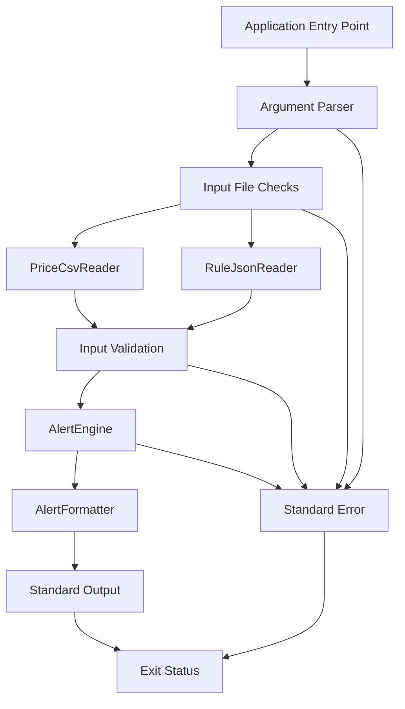
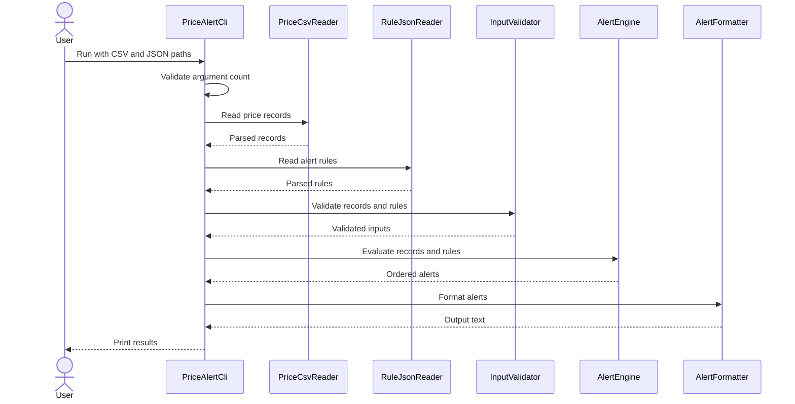

# Low-Level Design 02 — CLI and File Processing

## 1. Purpose

This document defines the command-line interface, file formats, parsing responsibilities, validation flow, output behavior, and error handling for the Price Alert Tool MVP.

The CLI is an adapter between external files and the core alert engine. It must not contain the alert evaluation algorithms.

## 2. CLI Contract

The intended command is:

```bash
java -jar target/price-alert-tool-1.0-SNAPSHOT.jar prices.csv rules.json
```

The command accepts:

- `prices.csv`: historical price observations.
- `rules.json`: configured alert rules.

The executable shaded JAR produced by Maven is `target/price-alert-tool-1.0-SNAPSHOT.jar`.

The CLI should:

1. Validate command-line arguments.
2. Verify that input files can be accessed.
3. Parse the CSV and JSON files.
4. Validate parsed data.
5. Invoke the core alert engine.
6. Format and print ordered alerts.
7. Report failures clearly and return a non-zero exit code.

## 3. CLI Architecture



## 4. Suggested Class Responsibilities

Class names may be adjusted to match the actual project, but responsibilities should remain separate.

### 4.1 Main

Responsibilities:

- Provide the Java application entry point.
- Delegate command execution to the CLI application component.
- Avoid implementing parsing or alert evaluation directly.

### 4.2 PriceAlertCli

Responsibilities:

- Coordinate the command execution flow.
- Receive validated command-line arguments.
- Invoke the readers and core engine.
- Send formatted results to the output layer.
- Convert expected failures into clear error messages and an unsuccessful exit status.

It should not implement level-crossing or moving-average algorithms.

### 4.3 PriceCsvReader

Responsibilities:

- Read the prices CSV file using Apache Commons CSV.
- Check for required headers.
- Convert each row into a `PriceRecord`.
- Report malformed rows with row context where practical.
- Close file resources reliably.

### 4.4 RuleJsonReader

Responsibilities:

- Read the JSON rules file using Jackson.
- Deserialize rule definitions.
- Detect malformed JSON and incompatible field values.
- Return parsed rules to the validation layer.

### 4.5 InputValidator

Responsibilities:

- Validate required values.
- Check date, instrument, and decimal constraints.
- Validate rule IDs and rule-specific parameters.
- Reject unsupported rule types.
- Apply the documented policy for duplicates and invalid records.

The validator should not calculate alert conditions.

### 4.6 AlertFormatter

Responsibilities:

- Convert alerts into a stable, human-readable output format.
- Ensure output is predictable and easy to verify.
- Avoid mixing diagnostics into normal result output.

The exact format must be finalized and documented once implementation begins.

## 5. Input File Formats

### 5.1 Prices CSV

Required headers:

```csv
date,instrument,close
2026-01-01,ABC,100.00
2026-01-03,ABC,110.00
2026-01-02,ABC,105.00
2026-01-01,XYZ,45.50
```

The sample deliberately contains unordered dates.

Rules:

- `date` uses ISO format `YYYY-MM-DD`.
- `instrument` is a non-empty identifier.
- `close` is parsed as `BigDecimal`.
- `close` must be strictly positive; zero and negative prices are rejected.
- Header names must match the documented schema.
- Each row represents one price observation.
- The reader preserves the parsed observations; chronological sorting belongs to the core engine or its explicitly designated preprocessing step.
- A header-only file is valid and represents an empty price history; a missing header is invalid.
- Duplicate observations for the same instrument and date are rejected by the engine.
- Calendar gaps are ignored; only observed records determine the chronological sequence.
- Malformed quoting and malformed rows are rejected rather than skipped.

The example data is illustrative, not a required dataset.

### 5.2 Rules JSON

The root element is a JSON array.

Illustrative level rule:

```json
{
  "id": "r1",
  "instrument": "INFY",
  "type": "level",
  "direction": "below",
  "level": 1500
}
```

Illustrative moving-average crossover rule:

```json
{
  "id": "r2",
  "instrument": "TCS",
  "type": "ma_cross",
  "short": 5,
  "long": 20,
  "direction": "above"
}
```

A complete file can contain multiple rule objects:

```json
[
  {
    "id": "r1",
    "instrument": "INFY",
    "type": "level",
    "direction": "below",
    "level": 1500
  },
  {
    "id": "r2",
    "instrument": "TCS",
    "type": "ma_cross",
    "short": 5,
    "long": 20,
    "direction": "above"
  }
]
```

Types and directions are case-insensitive. Official fields are `level` with `direction` (`above` or `below`), and `short`/`long` with `direction`. Legacy `threshold` and `shortWindow`/`longWindow` aliases remain supported; if both aliases for a value are present, they must match. Omitted direction retains legacy behavior and detects either crossing. Unsupported fields, conflicting aliases, duplicate JSON properties, and duplicate rule IDs are rejected.

JSON numeric levels are deserialized as `BigDecimal` with decimal precision preserved. Levels may be zero or negative; MA_CROSS windows must be positive integers with the short window strictly less than the long window.

## 6. File Processing Sequence



If a stage fails, the CLI should stop processing, report the error, and return an unsuccessful exit status.

## 7. Validation Policy

### Command-Line Arguments

- Require exactly the documented number of arguments.
- Print a usage message when arguments are missing or invalid.
- Reject paths that do not identify readable files.
- Do not start evaluation when input files cannot be read.
- Argument-count errors and input errors are written to standard error and return non-zero status. Valid no-alert evaluations return status `0`.

### CSV Validation

- Check required headers.
- Reject malformed dates.
- Reject invalid, zero, or negative decimal prices.
- Reject blank required fields.
- Reject malformed CSV quoting and rows with the wrong number of columns.
- Include the source row number in an error when practical.
- Reject duplicate instrument/date observations during evaluation.
- Do not silently reorder or discard malformed values during parsing.

### JSON Validation

- Require the expected root array.
- Require rule IDs, instruments, and rule types.
- Require the parameters appropriate to each rule type.
- Reject unsupported rule types.
- Validate moving-average window sizes.
- Reject duplicate rule IDs during evaluation.
- Provide useful diagnostics for malformed JSON.
- Preserve decimal precision in numeric thresholds.

### Error Policy

The MVP should use a simple, predictable policy: invalid input prevents the evaluation from running, rather than silently producing potentially misleading alerts from partially accepted data.

If partial acceptance is chosen later, it must be explicitly specified, reported to the user, and covered by tests.

## 8. Output and Exit Behavior

### Standard Output

Contains the formatted alert results only. When no alerts are generated, the application should print a clear no-alerts message or an empty result according to the chosen output contract.

### Standard Error

Contains diagnostics such as:

- Invalid arguments.
- Missing or unreadable files.
- Malformed CSV rows.
- Invalid JSON.
- Rule validation failures.
- Unexpected evaluation failures.

Error output should be concise and actionable. Stack traces should not be printed for ordinary user input errors.

### Exit Status

- `0`: the command completed successfully, including a valid evaluation with no alerts.
- Non-zero: argument, input, validation, or execution failure.

The CLI returns `2` for an incorrect argument count and `1` for path, parsing, or validation errors. It prints `No alerts generated.` for valid evaluations that produce no alerts, including empty rules or a header-only price history.

## 9. Resource Management

- Use try-with-resources or equivalent safe resource management for file readers and parsers.
- Ensure files are closed even when parsing fails.
- Avoid reading the same file multiple times without a reason.
- Keep file handling separate from evaluation logic.

## 10. Testing Strategy

### PriceCsvReader Tests

- Valid CSV.
- Missing required header.
- Invalid date.
- Invalid decimal.
- Empty instrument.
- Blank or malformed row.
- Duplicate instrument/date observations according to the chosen policy.
- Unordered dates.

### RuleJsonReader Tests

- Valid JSON with one rule.
- Valid JSON with multiple rules.
- Malformed JSON.
- Empty rule array.
- Unsupported rule type.
- Missing required field.
- Invalid moving-average windows.
- Duplicate rule IDs according to the chosen policy.

### CLI Tests

- Missing arguments.
- Too many arguments.
- Missing input file.
- Valid files that produce alerts.
- Valid files that produce no alerts.
- Invalid input returns a non-zero exit status.
- Alerts are printed in date-then-rule-ID order.
- Standard output and standard error are used consistently.

### End-to-End Smoke Test

Build the application, run it with sample files, and verify the output against expected alerts. The documented command must work from a clean checkout after the documented build step.

## 11. Example Execution

After building the executable JAR, the intended workflow is:

```bash
mvn clean test
mvn package
java -jar target/price-alert-tool-1.0-SNAPSHOT.jar prices.csv rules.json
```

## 12. Implementation Boundaries

The CLI layer may depend on the core engine, Apache Commons CSV, and Jackson.

The core engine must not depend on:

- Console input or output.
- Command-line argument parsing.
- File paths.
- CSV or JSON parser classes.
- Spring Boot controllers.
- Database repositories.
- Frontend-specific models.

This boundary keeps the initial CLI straightforward while allowing a future REST API to reuse the same engine.
