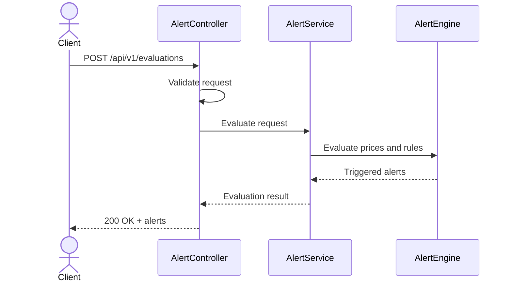

# LLD 03 — REST API

**Status:** Planned — Phase 2. Not part of the current MVP.

## 1. Purpose

Expose the existing Price Alert Tool engine through HTTP endpoints. The REST API must reuse the core engine and must not implement alert calculations independently.

## 2. Technology

- Java 21
- Spring Boot
- Spring Web
- Bean Validation

Exact dependency versions will be selected when Phase 2 begins.

## 3. Components

### AlertController
Receives HTTP requests, validates request-level constraints, and returns HTTP responses.

### AlertService
Coordinates the request, invokes the core alert engine, and returns evaluation results.

### Core AlertEngine
Evaluates price records against configured rules. This component is shared with the CLI and remains independent of Spring Boot.

### API DTOs
Represent HTTP request and response payloads. DTOs must not be coupled unnecessarily to internal domain models.

## 4. Proposed Endpoints

### POST /api/v1/evaluations

Accepts historical prices and alert rules, evaluates them, and returns the triggered alerts.

Request body:

- `prices`: array of date, instrument, and close values.
- `rules`: array of supported alert configurations.

Successful response: `200 OK`, containing the generated alerts.

### GET /api/v1/health

Provides a basic application health response.

### Future endpoints

After persistence is implemented:
- `GET /api/v1/evaluations/{id}`
- `GET /api/v1/alerts`
- `GET /api/v1/evaluations`

These endpoints are not implemented in Phase 2 unless explicitly added to its scope.

## 5. Request Processing Sequence

## 6. Error Handling

- `400 Bad Request`: malformed payload or invalid request data.
- `413 Content Too Large`: request exceeds the configured size limit.
- `500 Internal Server Error`: unexpected server-side failure.

Error responses should use a consistent JSON structure and must not expose stack traces or sensitive implementation details.

## 7. Design Constraints

- The REST API must not duplicate alert-evaluation logic.
- The CLI must continue to work independently.
- API DTOs must be converted to validated domain inputs.
- The API must return deterministic alert ordering.
- Database access is not introduced until Phase 3.
- Authentication and authorization are future concerns if the application becomes multi-user or publicly accessible.

## 8. Future Integration

Phase 3 will introduce persistence behind a repository/service boundary. Phase 4 will add a web frontend that calls these endpoints. Neither extension should require changes to the mathematical definitions of the alert rules.