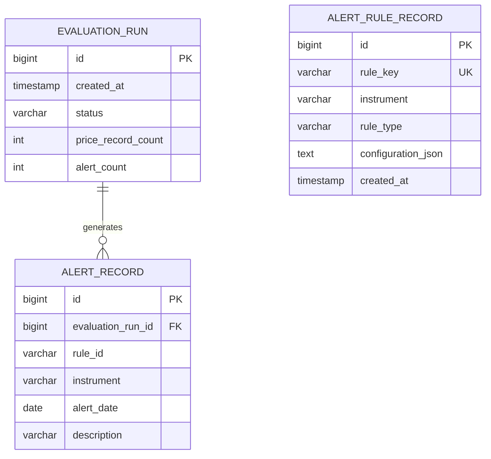

# LLD 04 — Persistence and Web UI

**Status:** Planned — Phases 3 and 4. Not part of the current MVP.

## 1. Purpose

Define how evaluation history and triggered alerts will be stored, and how the future web dashboard will interact with the REST API.

## 2. Planned Technology

- PostgreSQL for durable persistence.
- Spring Data JPA for repository access.
- Flyway for version-controlled database migrations.
- React with TypeScript for the frontend.

## 3. Proposed Data Model

### EvaluationRun

Represents one completed evaluation request.

Fields:
- `id`: primary key.
- `created_at`: evaluation creation timestamp.
- `status`: evaluation status.
- `price_record_count`: number of input records.
- `alert_count`: number of alerts generated.

### AlertRecord

Represents one alert generated during an evaluation.

Fields:
- `id`: primary key.
- `evaluation_run_id`: foreign key to EvaluationRun.
- `rule_id`: identifier of the triggering rule.
- `instrument`: instrument symbol.
- `alert_date`: trading date.
- `description`: human-readable alert description.

### AlertRuleRecord

Represents a persisted rule configuration, if rule management is introduced.

Fields:
- `id`: primary key.
- `rule_key`: stable rule identifier.
- `instrument`: instrument symbol.
- `rule_type`: level or moving-average crossover.
- `configuration_json`: validated rule configuration.
- `created_at`: creation timestamp.

Persisted rule management is optional and should not be added unless required by the implemented user workflow.

## 4. Proposed Entity Relationship Diagram

The rule-configuration entity is shown as independent because a historical alert should retain the rule identifier and description associated with the evaluation, even if the rule is later changed or deleted.

## 5. Persistence Rules

- Store completed evaluation results transactionally.
- Ensure each alert belongs to an evaluation run.
- Use database migrations rather than relying on automatic schema generation in production.
- Define explicit behavior for failed evaluations.
- Preserve historical evaluation results.
- Avoid storing unnecessary copies of large input files.

## 6. REST API Integration

Phase 3 may persist completed evaluations and expose their identifiers. Phase 4 can retrieve evaluation history and display alerts through the existing REST API.

Database access must remain outside the core alert engine.

## 7. Proposed Web Interface

The React dashboard may provide:
- CSV upload.
- Alert-rule configuration.
- Evaluation submission.
- Alert results.
- Evaluation history.

The frontend must call the REST API instead of implementing alert calculations locally.

## 8. Security and Operational Considerations

Before public deployment:
- Limit upload sizes.
- Validate uploaded data on the server.
- Restrict database credentials to the required permissions.
- Store secrets in environment variables or a secrets manager.
- Configure CORS deliberately.
- Add authentication and authorization if the application becomes multi-user.

## 9. Scope Boundary

The database and web interface are planned extensions. The original CLI remains a supported entry point, and the current MVP requires neither a database nor a frontend.